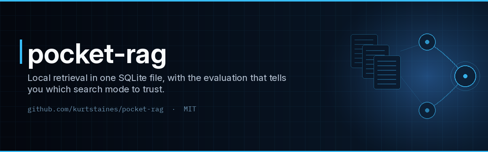
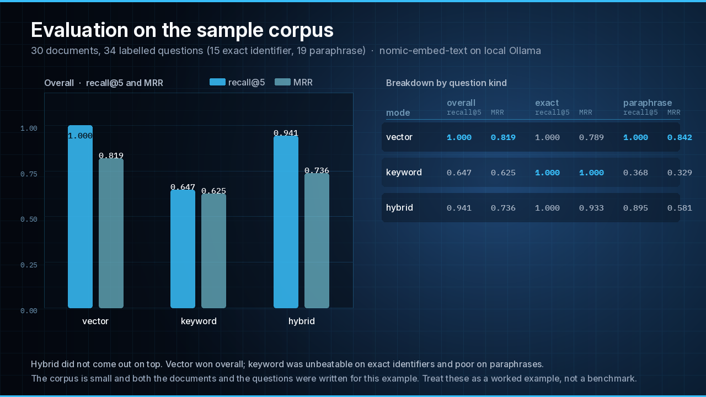
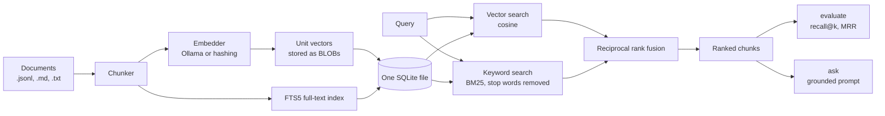

# pocket-rag



[](https://github.com/kurtstaines/pocket-rag/actions/workflows/ci.yml)
[](https://github.com/kurtstaines/pocket-rag/blob/main/LICENSE)


**Local retrieval in one SQLite file, with the evaluation that tells you which search mode to trust.**



*recall@5 and MRR on the 34 labelled sample queries with nomic-embed-text. Hybrid did not come out on top.*

Most retrieval demos stop at "it returned something plausible". `pocket-rag` indexes your documents with a local embedding model, searches them three ways (vector, keyword, hybrid), and then measures all three against labelled questions, so the choice of search mode is a number instead of a belief.

It has no dependencies beyond the Python standard library. Embeddings come from a local [Ollama](https://ollama.com) model, so nothing leaves your machine.

Status: **v0.1, early.** Small on purpose.

## What the evaluation showed

The repo ships a small sample corpus (30 short documents for a fictional API) and 34 labelled questions: 15 that quote an exact identifier such as an error code or header name, and 19 that paraphrase the answer without sharing its words. Measured with `nomic-embed-text` on a local Ollama:

| search mode | recall@5 | MRR | recall@5, exact | MRR, exact | recall@5, paraphrase | MRR, paraphrase |
|---|---|---|---|---|---|---|
| vector | **1.000** | **0.819** | 1.000 | 0.789 | **1.000** | **0.842** |
| keyword | 0.647 | 0.625 | 1.000 | **1.000** | 0.368 | 0.329 |
| hybrid | 0.941 | 0.736 | 1.000 | 0.933 | 0.895 | 0.581 |

What that says, for this corpus:

- **Keyword search is unbeatable on exact identifiers** and poor on paraphrases.
- **Vector search is the reverse**, and with a good embedding model it wins overall here.
- **Hybrid did not come out on top.** It was the safest choice on identifier questions after keyword, but on paraphrases the keyword half pulled in wrong documents and cost it rank.

That last result is the reason the harness exists: "hybrid is always better" is a common assumption, and on this data it is false. The corpus is small and I wrote both the documents and the questions, so treat these as a worked example, not a benchmark. Run it on your own documents.

Reproduce it:

```bash
ollama pull nomic-embed-text
pocket-rag index orbit.db examples/orbit/docs.jsonl
pocket-rag eval orbit.db examples/orbit/queries.jsonl --by kind
```

## Features

- **One file per corpus.** Chunks, embeddings and the full-text index live in a single SQLite database.
- **Three search modes** over the same chunks: cosine similarity, SQLite FTS5 with BM25, and reciprocal rank fusion of the two.
- **Evaluation built in.** Recall@k and mean reciprocal rank for every mode, with an optional breakdown by any field in your question file.
- **Grounded prompts.** `ask` builds a prompt from the retrieved passages with their source ids and can pipe it to any command-line model.
- **Paragraph-aware chunking** with overlap for oversized paragraphs.
- **Safe re-indexing.** Adding a document again replaces its old chunks, and an index refuses to be searched with a different embedding model than it was built with.
- **An offline baseline embedder** (hashed bag of words) for tests and for seeing what a real model adds.

## Quickstart

```bash
git clone https://github.com/kurtstaines/pocket-rag.git
cd pocket-rag
pip install -e .
pocket-rag index orbit.db examples/orbit/docs.jsonl --embedder hashing
pocket-rag search orbit.db "E4291"
```

That runs with no model at all. For real embeddings, install Ollama, run `ollama pull nomic-embed-text`, and drop the `--embedder hashing` flag.

## Commands

| Command | What it does |
|---|---|
| `pocket-rag index DB SOURCE` | Indexes a `.jsonl` file of `{"id", "text"}` records, or every `.md` and `.txt` file under a folder. `--embedder hashing` or `ollama:<model>`; `--max-chars` sets chunk size. |
| `pocket-rag search DB "query"` | Prints the top chunks. `-k` results, `--mode vector`, `keyword` or `hybrid` (default). |
| `pocket-rag eval DB QUERIES` | Scores all three modes on a `.jsonl` file of `{"query", "relevant": [doc ids]}`. `--by FIELD` adds a breakdown. |
| `pocket-rag ask DB "question"` | Prints a grounded prompt with cited passages, or pipes it to `--llm "<command>"`, for example `--llm "ollama run llama3.2"`. |

## Use it from Python

```python
from pocket_rag import core

index = core.Index("docs.db", core.ollama_embedder("nomic-embed-text"))
index.add([("guide", open("guide.md", encoding="utf-8").read())])

for hit in index.search("how do I rotate a key", k=3):
    print(hit["id"], hit["text"][:80])

report = core.evaluate(index, [{"query": "rotate a key", "relevant": ["guide"]}])
```

An embedder is any function that turns a list of strings into a list of vectors, so another provider is a few lines.

## How it works



## Limits

- **Vector search is a brute-force scan in pure Python.** That is fine to roughly 50,000 chunks; beyond that it needs numpy or a vector extension.
- **Keyword search is tuned for English**: the stop-word list and tokenizer are English-only.
- **No reranker, no query rewriting, no metadata filters.**
- **The sample corpus is small and self-authored**, as noted above.

## Tests

```bash
pip install -e ".[dev]"
pytest
```

19 tests cover chunking, indexing and re-indexing, each search mode, rank fusion, protection against full-text query injection, the evaluation maths, the sample corpus's consistency, both embedders (the Ollama one against a local stub server) and the command line. They run offline; CI does not have Ollama, so the numbers in the table above come from a local run, not from CI.

## Roadmap

- Task prefixes for embedding models that expect them
- A reranking stage, measured with the same harness
- Metadata filters
- A vector extension for larger corpora

## Contributing

Issues and pull requests are welcome. Before opening a PR:

```bash
ruff check . && ruff format --check . && pytest
```

## License

MIT. See [LICENSE](https://github.com/kurtstaines/pocket-rag/blob/main/LICENSE).
